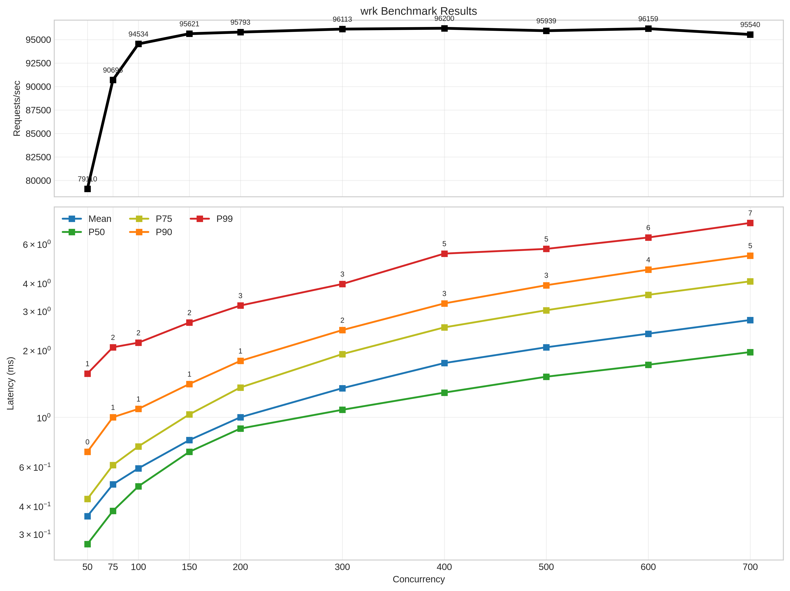
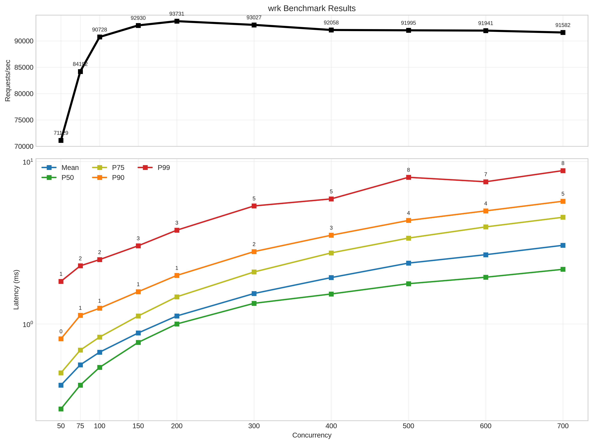
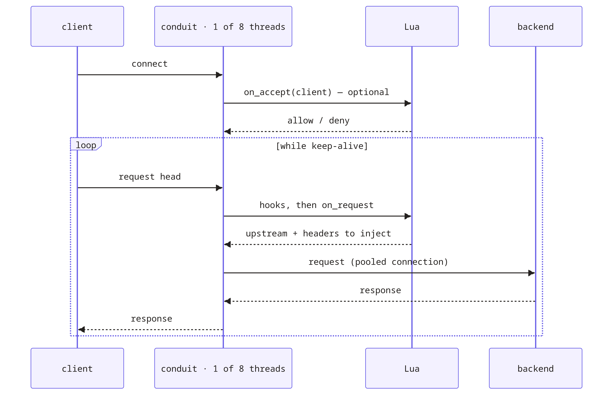
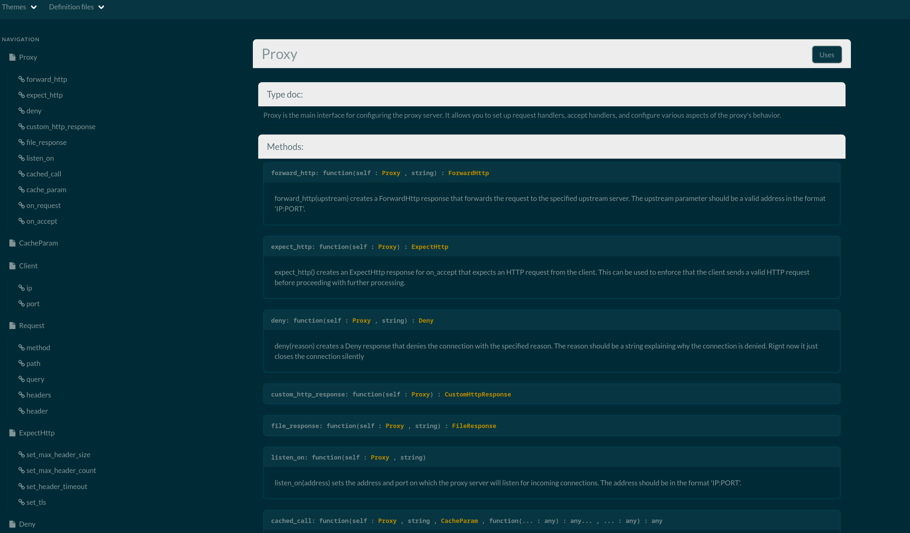

# Conduit

> [!NOTE]
> Curretly, it is in a highly experimental state.
> We have only implemented the things that are the core of our idea. io_uring proxy with lua.

Conduit is the implementation of our idea; having a lua native configuration in a reverse proxy.
We imagined having a programmable and dynamic deciding layer direcly in the reverse proxy path is kinda cool and we can achieve many thing direcly from reverse proxy without ever talking to the backend. In that sense, it is true but we have also realized that trying to do so much in highly concurrent hot path like in our proxy core is not much of a great idea. Still, having lua is pretty cool and it is faily cheap. For a simple configuration that just tells what to do and does't do much by itself, it is pretty fast and only adds a little overhead.
Concurrency curves below shows that requets per second only decreases by little bit on adding lua.

| No lua;hardcoded backend address | Simple lua config (1st example below) |
|----------------------------------|-------------------|
|||

> [!NOTE]
> All the benchmarks presented here were generated informally with everything running locally on my laptop.
> wrk,proxy and backend all running on the same device

On top of lua, our implementation uses monoio with io_uring backend drastically reducing the syscalls per request. It makes our proxy generally faster. Infact, at this stage and in our localhost benchmark, our proxy is almost faster if not as fast as nginx with simple lua configration.

### Nginx Syscalls

| Major syscalls | syscalls per request |
|----------------|----------------------|
|   writev       |        2.00 /req     |
|   recvfrom     |        2.00 /req     |
|   getsockopt   |        1.00 /req     | 
|   epoll_wait   |        0.18 /req     |
|   **TOTAL**    |        **5.19 /req** |

### Conduit Syscalls

| Major syscalls | syscalls per request |
|----------------|----------------------|
|   recvfrom     |        1.00 /req     |
|   io_uring_enter|       0.34 /req     |
|   **TOTAL**    |        **1.35 /req** |

*This data was generated from the script `./benches/syscalls.sh`*

## Usage

Here's the sequence you should know before you use this.



- **`on_accept`:** will be called after accepting a connection from client, before any http parsing. It mainly decides whether to let this request through or not Or should it be redirected? (Optional)
```lua
proxy:on_accept(function(client)
    if client.ip == "10.100.1.1" then
        local handler_resp = proxy:expect_http()
        handler_resp:set_max_header_size(16384)
        handler_resp:set_max_header_count(64)
        handler_resp:set_header_timeout(5)
        return handler_resp
    else
        return proxy:deny("NOPE")
    end
end)
```

Header size is limited to 64 KiB and the parser supports at most 64 headers;
the setters can lower these limits for a connection or upstream response.
- **`on_request`** will be called after parsing the request http with client and request information. It decides where to send this request (upstream) and it can do some request bending as well if needed.
```lua
proxy:on_request("example.com", function(client, req)
    handler_resp = proxy:forward_http("127.0.0.1:8000")
    handler_resp:add_header("X_PROXY", "CONDUIT")
    handler_resp:set_max_request_body_size(1048576)
    handler_resp:set_max_response_body_size(1048576)
    handler_resp:set_max_response_header_size(8192)
    handler_resp:set_max_response_header_count(64)
    handler_resp:set_connect_timeout(5)
    handler_resp:set_client_body_timeout(30)
    handler_resp:set_proxy_read_timeout(30)
    return handler_resp
end)
```

Request and response body-size limits are configured separately. Forward
timeouts are total deadlines for connecting, relaying the request, and
reading/relaying the response; passing `nil` disables a forward timeout.

All this and other setting will go in `config.lua` as
```lua
-- proxy:on_accept skipped
proxy:on_request("example.com", function(client, req)
    handler_resp = proxy:forward_http("127.0.0.1:8000")
    handler_resp:keep_alive(false)
    handler_resp:add_header("X_GREETING", "HELLO")
    return handler_resp
end)

proxy:listen_on("127.0.0.1:5000")
```

## Docs

If you wish to take a peek into our thought process, design and notes, they live in [`docs/dev/`](docs/dev):

### Lua API docs

The `proxy` API is described by the Rust types themselves so that docs can't drift.

Every type Lua can see implements tealr's `TealData`, and `main.rs` walks them at
startup with `TypeWalker`, writing the result to `conduit.json`:

```rust
TypeWalker::new()
    .process_type::<Proxy>()
    .process_type::<ClientHandle>()
    .process_type::<RequestHandle>()
    // ...
```

From that, tealr_doc_gen generates
browsable docs and type definitions:

```
cargo install tealr_doc_gen     # once
./target/release/conduit        # refreshes conduit.json
tealr_doc_gen run               # writes pages/
```

- *`pages/index.html`* is the browsable reference (Here's the screenshot of the generated doc)



- *`pages/definitions/conduit.d.tl`* is a Teal for completion and type checking in config.lua
