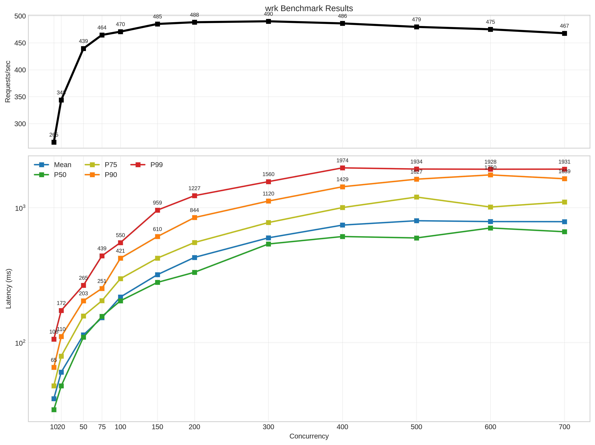
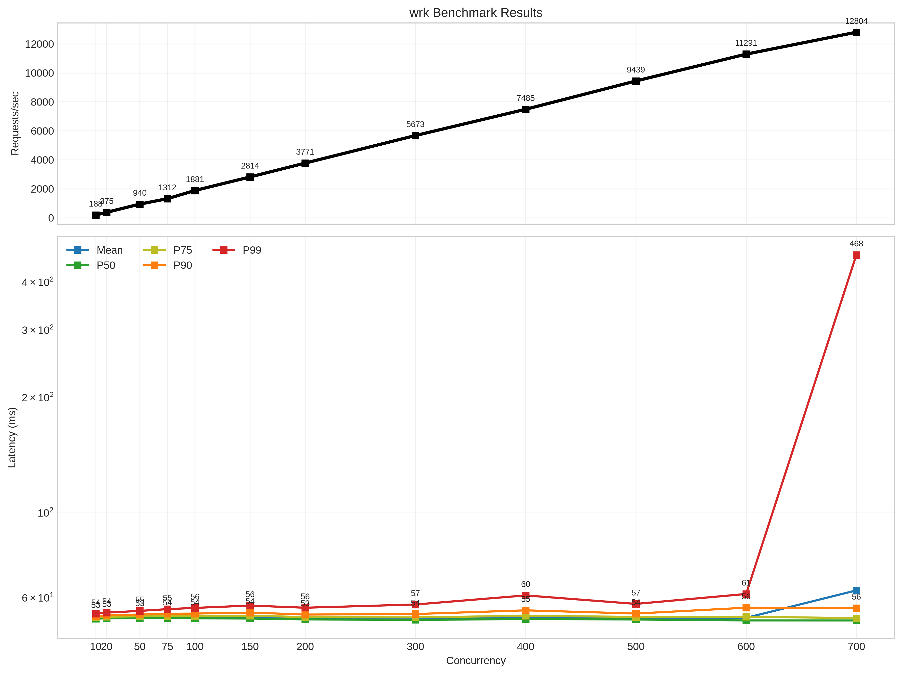

### Aug 4, 2026

What happens when a lua function does something blocking.

You might think, ok, so what, that request blocks, other request gets their turn.
Request ratency will increse but my request per second won't get hurt.

Good instinct. That's what i thought. I said, mlua gives `call_async`, i will use that and i will have what i needed.

But no, for async function to work, blocking task need to yield. call_async will basically only give a future.
And when it gets polled later, if it never yields until it finished, it will block the thread.
And that is exactly happens when our lua function if it calls something blocking.

Since the program state will goto lua side when we call a lua function, it can never yeild back to rust runtime.

To test that, i made a lua module that calls a socket:sleep inside a lua function and sleeps for 15ms. Lets see how devastating that is

*Concurrency Curve with sleeptest module (blocking)*

We have 8 threads
Since 15ms is the domanating time. Lets say each request just takes 15ms. That is 15ms of just blocking. Not read, write, io as with normal request forward. Just 15ms thread time for each request.
So, each thread can do 1/(15 / 1000) ~ 67 rps
and with 8 threads, at max ~ 536 rps which is reflected in the graph.

And each request is spend most of its time blocking without giving space for other requests in the thread (normally it should since it is async), it will mostly behave as simple queue.
So for the last request in the queue, it has to wait for all other 66 requests to finish before it gets its turn (of course i am simplifying things here) so that is 67 * 15 ms = 1005ms for the last request. This should also explain the latency we are seeing.

Now to see how it would affect if that sleep could yield. I added a rust side sleep function created with `create_async_function` in mlua.
If the module calls that. we get something like.

**Note: Now it is 50ms wait, not 15.**

*Concurrency Curve with sleeptest module (non blocking)*

In lower concurrency, all the requests are sleeping. They yielded, proxy has the capacity but the incomming requests are limited.
And when more requets come at once with increasing concurrency, proxy can easily handle that. So we see that linear growth in request in per second. System is *stable*. Each request's latency are roughly 50ms meaning they are coming anbd getting served by the proxy almost instantly. No waiting in the queue. Since they yielding when polled, proxy is free to take in more requests.
And it seems that we hit that free confirtable area for proxy at around c700 and we are back to requests waiting for their turn.

### What does that mean for us?

We have to implement the io primitive in rust side and override. Like where can a application block, in sleep, in read writes.
We have to reimplement the part of that by ourself. Like reimplementing parts of luasockets... That's a whole lot of thing to do lol.
