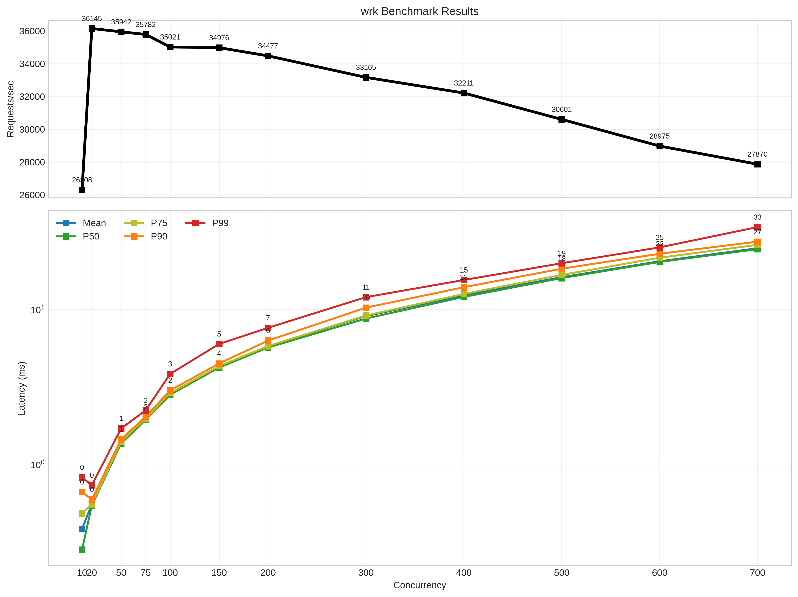
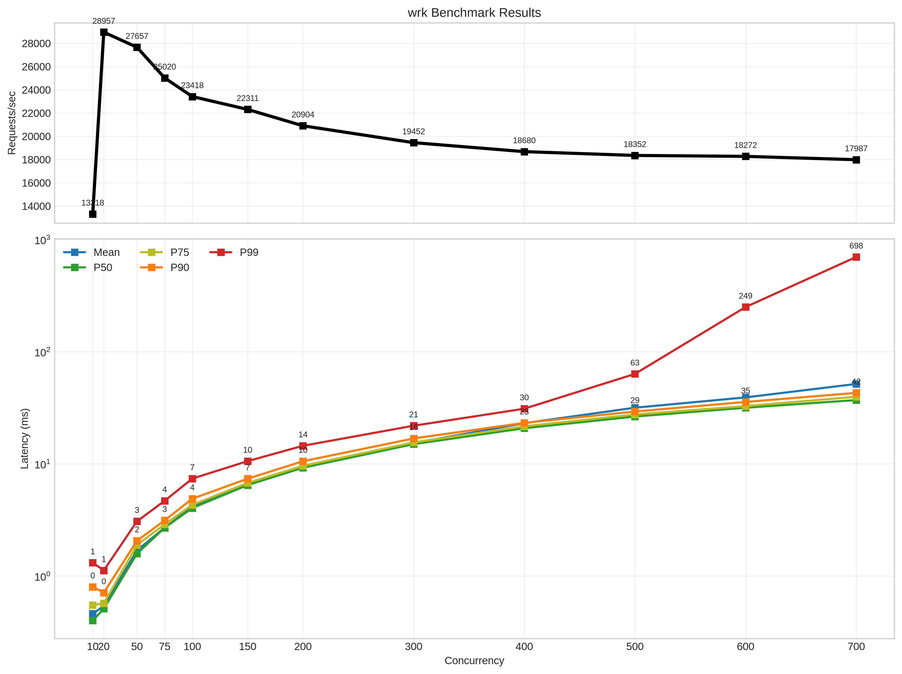
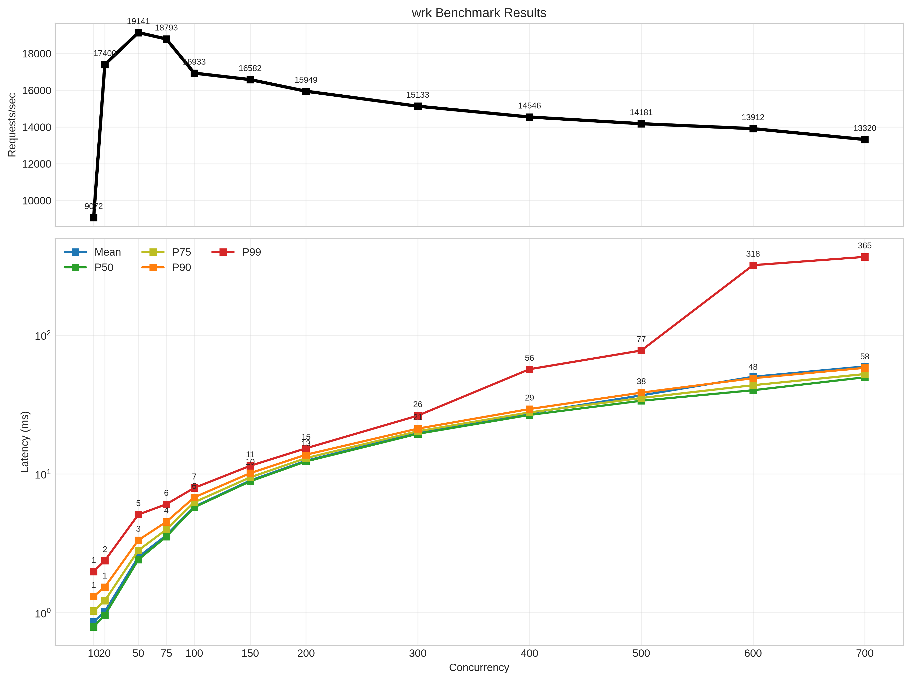

### Aug 4, 2026

So, I plotted the the latency and request per second graph for difference concurrency level.
Got some intresting result.

Let me begin with a concurrency curve when we direcly hit the backend server.
With a increased concurrency, it is obviously getting slow but its growing naturally and in a predictable way.

*Concurrency Curve with direct request to the backend server*

Now, lets see what our implementation does.I will begin with just raw request forwarding without any lua in the middle.

*Concurrency Curve with request through our proxy; without lua*

I hardcoded the upsteram url in resovle backend. As it can be seen, tail latency (p99) is getting out of hand with more concurrency.
**Why?**

And rps also drops heavily after c50. Why?

Now lets add a a lua layer. A simple `on_requet` function that runs in every request and adds few headers (and cached modules; but they should affect much since they are cached for almost every requests)

*Concurrency Curve with request through our proxy; with only `on_request` adding few headers*

RPS dropped overall and latency is incrased a little but the overall shape is similar.

Lets add another lua layer. A module that runs in every request with `on_request`. I make a simple blessing moduel that give blessing to the backend with every request lol.

*Concurrency Curve with request through our proxy; with both `on_request` and `blessing` moduel running on each request*

It doesn't differ very much from previous run. I think lua function doesn't adds much latency if it is just lua.

But now lets see what happens when lua function that run in every request does some blocking task (waits for redis). I made a simple ratelimit module that uses redis

*Concurrency Curve with request through our proxy; with redis ratelimit module*

Each request blocked on redis and it obviously decreased request per seconds. But if we see p99 on c700. It is more gentler. Why? Or maybe it is just randomness. I don't know. I gotta look closely.

**NOTE:** Regarding this issue of blocking task inside lua. I will talk about it in another note.
[[async_io_in_lua]]
